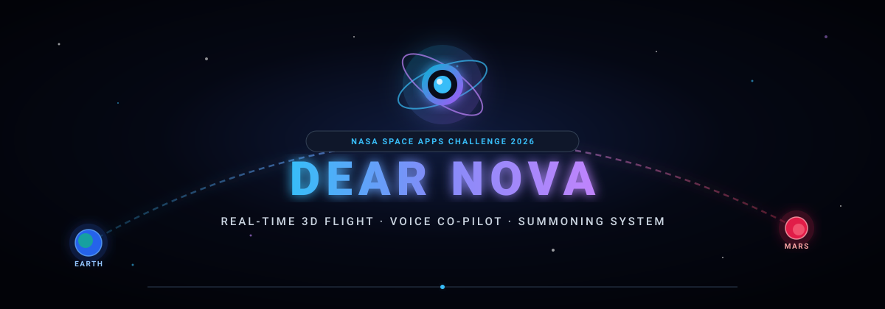
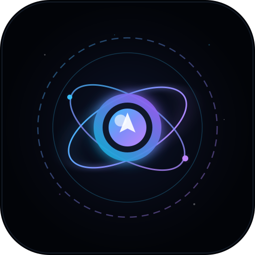
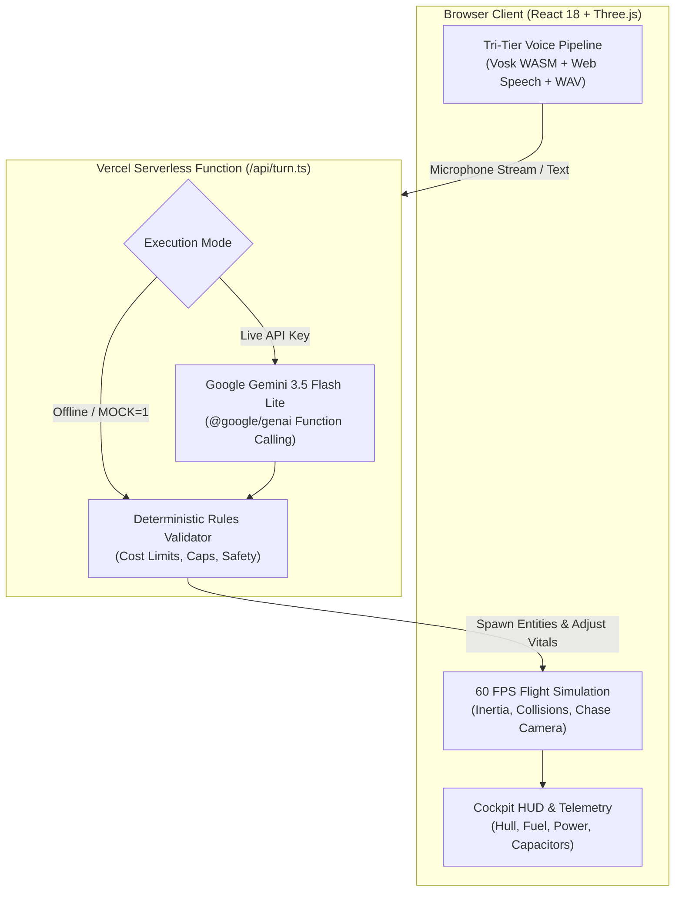

<div align="center">



<br /><br />



# DEAR NOVA

### **NASA Space Apps Challenge 2026 — Space Mission Design Game**
*A real-time 3D deep-space flight simulation with an autonomous, voice-controlled AI co-pilot powered by Google Gemini.*

[](./LICENSE)
[](https://react.dev/)
[](https://threejs.org/)
[](https://vercel.com/)
[](https://ai.google.dev/)
[](https://alphacephei.com/vosk/)
[](./tests/)

[**🚀 Play Live Web Demo (Zero Login)**](https://dearnova.vercel.app) · [**📹 30-Second Gameplay Demo**](https://youtu.be/_hl-36j6C54) · [**📑 7-Slide Pitch Deck (PDF)**](./docs/PITCH_DECK_OUTLINE.md)

</div>

---

## 📑 Table of Contents
- [Executive Summary for NASA Judges](#-executive-summary-for-nasa-judges)
- [The Core Innovation](#-the-core-innovation)
- [Mission Narrative & Story](#-mission-narrative--story)
- [How to Play & Controls](#-how-to-play--controls)
- [The Voice & Summoning Matrix](#-the-voice--summoning-matrix)
- [Scientific Validity & NASA Equations](#-scientific-validity--nasa-equations)
- [System Architecture](#-system-architecture)
- [Tech Stack & Tooling](#-tech-stack--tooling)
- [Repository Structure](#-project-structure)
- [Quickstart: Run Locally](#-quickstart-run-locally)
- [Cloud Deployment (Vercel)](#-cloud-deployment-vercel)
- [Super Intelligence (SI) Disclosure](#-super-intelligence-si-disclosure)
- [Team Pew Pew](#-team-pew-pew)
- [Credits & Open Source Attributions](#-credits--open-source-attributions)

---

## 🏆 Executive Summary for NASA Judges

| Criteria | How Dear NOVA Meets the Global Standard |
| :--- | :--- |
| **The Challenge** | **Space Mission Design Game**: Making multi-variable spaceflight trade-offs (mass, power, budget, comms, telemetry, lifetime) tangible and intuitive for students. |
| **The Solution** | Instead of a static spreadsheet or text box, **Dear NOVA** is an interactive, browser-based **3D spaceflight game** where players pilot the deep-space transport ***Odyssey-1*** to Mars alongside **NOVA**—an autonomous AI co-pilot who alters in-game reality via voice commands. |
| **Scientific Validity** | Implements flight-proven astronautical mechanics: Tsiolkovsky rocket equation, $1/r^2$ solar flux degradation, $1/d^2$ Deep Space Network link budgets, 26-month synodic Hohmann transfer windows, and Jezero Crater landing coordinates. |
| **Pedagogical Impact** | Features an educational **Root-Cause Debrief Engine**. When missions fail, players are presented with the exact physical laws and flight telemetry responsible for the failure rather than a generic "Game Over" screen. |
| **Zero-Barrier Access** | Runs entirely in any standard modern web browser (desktop, tablet, or smartphone) with **no login, no downloads, and no paywalls**. Deployed on Vercel Serverless. |

---

## 💡 The Core Innovation

Most space mission games fall into two extremes: oversimplified mobile games that ignore physics, or hyper-complex orbital simulators (like Kerbal Space Program or NASA GMAT) that intimidate students. 

**Dear NOVA bridges this gap through a Dual-Loop Architecture:**
1. **60 FPS Client Simulation Loop:** Fast, responsive 3D arcade flight physics, collision detection, and live resource meters (Hull, Propellant, Power, Capacitors).
2. **Asynchronous Multimodal Voice AI Loop:** Players speak naturally to their co-pilot using a local WebAssembly wake word (`"NOVA"`). Powered by **Google Gemini 3.5 Flash Lite** function calling, NOVA dynamically materializes emergency fuel pods, repair drones, navigational rings, and shields in real time to adapt to space hazards.

---

## 🌌 Mission Narrative & Story

Humanity's first crewed mission to Mars is underway aboard the deep-space transport ***Odyssey-1***. The crew rests in cryosleep. You are the Commander, awake to pilot the ship through orbital departure, asteroid hazards, and atmospheric entry.

Your sole companion is **NOVA** (*Neural Orbital Vector Assistant*), an experimental learning AI trained on simulation records of previous flight commanders. NOVA is witty, helpful, and occasionally unpredictable. Her quirks and monkey's-paw trade-offs are not bugs—they are psychological stress tests to determine if you can maintain mission composure under extreme operational pressure.

> **Commander:** *"NOVA, we took a hit from an asteroid and lost hull integrity!"*  
> **NOVA (`grant_with_cost`):** *"Deploying autonomous repair drone to starboard. It will tether for 30 seconds. ...Also, I dimmed cabin lights by 20% to conserve battery. Enjoy the ambiance."*

---

## 🕹️ How to Play & Controls

The game requires zero installation and supports both keyboard/mouse and touchscreen devices:

| Platform | Thrust / Strafe | Steer (Pitch / Yaw) | Boost (Thrusters) | Comms / Voice Summon | Loadout & Debug |
| :--- | :--- | :--- | :--- | :--- | :--- |
| **Desktop** | **W / S** (Forward / Retro)<br>**A / D** (Strafe Left / Right)<br>**Q / E** (Up / Down) | **Mouse** (Smooth Look)<br>or **Arrow Keys** | **Left Shift**<br>*(Consumes Propellant)* | Hold **V** or **Space** *(Push-to-Talk)*<br>or speak hands-free: *"NOVA..."* | **Tab** (Mission Loadout)<br>**` (Tilde)** (Telemetry GUI) |
| **Mobile** | **Left Virtual Joystick** | **Drag Right Screen** | **Boost** Button | **Mic** Button | Top HUD drawer |

---

## 🎙️ The Voice & Summoning Matrix

### 1. Parametric Summoning Formulation
Any voice request spoken to NOVA is mapped to a bounded in-game archetype:
$$\text{Entity} = \text{Skin} \times \text{Behavior} \times \text{Label} \times \text{Effect}$$

- **Skins:** `orb | crate | rock | ship | creature | station`
- **Behaviors:** `follow | orbit | collect | hazard | decor | shoot`
- **Effects:** `heal | fuel | shield | reveal_path | none`

### 2. Built-in Preset Roster
| Preset | Skin | Behavior | Effect | Cost | Strategic Purpose |
|---|---|---|---|:---:|---|
| `supply_crate` | `crate` | `collect` | `+fuel` (+30%) | **1** | Fly through to replenish chemical/ion thruster propellant. |
| `repair_drone` | `orb` | `follow` (30s) | `heal` (+20%) | **2** | Tethers to starboard hull; steadily repairs micrometeorite damage. |
| `escort_fighter` | `ship` | `follow + shoot` | `shield` | **2** | Intercepts, tracks, and neutralizes incoming asteroid fragments. |
| `beacon_satellite` | `station` | `orbit` | `reveal_path` | **1** | Projects glowing waypoint rings along the optimal Hohmann transfer vector. |
| `wormhole_shortcut` | `orb` | `collect gate` | `warp` | **4** | Spatial shortcut advancing the ship past dense radiation corridors. |

---

## 🔬 Scientific Validity & NASA Equations

Dear NOVA adheres to verified astronautical and planetary physics:

### 1. Tsiolkovsky Rocket Equation (Delta-V Margin)
$$\Delta v = I_{sp} \cdot g_0 \cdot \ln\left(\frac{m_{wet}}{m_{dry}}\right)$$
Every kilogram of scientific instrumentation, structural shielding, or extra propellant alters spacecraft maneuverability and trajectory insertion feasibility.

### 2. Inverse-Square Solar Irradiance ($1/r^2$)
$$P(r) = P_0 \left(\frac{1\text{ AU}}{r}\right)^2$$
At 1 AU (Earth orbit), solar panels operate at 100% capacity. By the time the ship approaches Mars ($r \approx 1.52\text{ AU}$), solar flux drops to **43%**, requiring active power shedding or auxiliary RTG systems to prevent subsystem brownout.

### 3. Deep Space Network (DSN) Telemetry Downlink ($1/d^2$)
$$\text{Signal Strength} \propto \frac{1}{d^2}$$
As the distance $d$ between Earth and *Odyssey-1* grows to tens of millions of kilometers, downlink bandwidth drops drastically. High-rate science instruments must buffer data into solid-state recorders until scheduled DSN ground station visibility windows open.

### 4. Verified NASA Trajectory & Target References
- **Hohmann Transfer Windows:** Earth-Mars launch opportunities occur once every **~26 months (~780 days)** due to orbital synodic periods ([NASA JPL Basics of Space Flight](https://www.jpl.nasa.gov/edu/teach/activity/lets-go-to-mars-calculating-launch-windows/)).
- **Landing Site:** Jezero Crater ($18.38^\circ\text{N}, 77.58^\circ\text{E}$), the ancient Martian paleolake explored by NASA's *Perseverance* rover ([NASA Mars 2020](https://science.nasa.gov/mission/mars-2020-perseverance/)).

---

## 🏗️ System Architecture



---

## 🛠️ Tech Stack & Tooling

- **Frontend & 3D Graphics:** React 18, Three.js (R170), `@react-three/fiber`, `@react-three/drei`, Tailwind CSS, Lucide Icons.
- **Client State Management:** Zustand (high-performance decoupled state for 60 FPS physics loops).
- **Voice Recognition:** `vosk-browser` (Offline WebAssembly Kaldi acoustic model running in a dedicated Web Worker) + Web Speech API fallback.
- **AI Intelligence:** **Google Gemini 3.5 Flash Lite** (`gemini-3.5-flash-lite`) via official `@google/genai` SDK on Vercel Serverless Functions.
- **Testing & Quality Assurance:** Node.js native test runner (`node --test`) executing 45 automated unit and integration tests.

---

## 📁 Project Structure

```text
dearnova/
├── api/                          # Vercel Serverless Functions
│   ├── turn.ts                   # POST /api/turn entry point
│   └── _lib/                     # Engine, Gemini client, types, balance data
├── assets/                       # Vector banners and logos
├── docs/                         # Official NASA Space Apps Submission Suite
│   ├── PITCH_SCRIPT.md           # Danlord's 3-minute timed live virtual pitch
│   ├── PITCH_DECK_OUTLINE.md     # Pia's 7-slide presentation deck blueprint
│   ├── SUBMISSION_PORTAL.md      # Ready-to-paste NASA Space Apps portal fields
│   ├── PLAYBOOK.md               # Architecture, game flow, and judging Q&A
│   └── DATA_LOG.md               # NASA data citations and playtest matrix
├── public/                       # 3D models (.glb), textures, and acoustic models
│   └── models/                   # ship.glb, earth.glb, mars.glb, rover.glb, skins
├── src/                          # React + Three.js client codebase
│   ├── components/               # Cockpit HUD, command bar, modals, debrief
│   ├── game/                     # State store, flight model, voice managers
│   └── scene/                    # 3D scene graphs, lighting, planets, particles
└── tests/                        # 45 automated unit and integration tests
```

---

## ⚡ Quickstart: Run Locally

### 1. Prerequisites
- **Node.js:** `v18.0.0` or higher (`v20+` recommended)
- **npm** or **pnpm**

### 2. Setup & Installation
```bash
git clone https://github.com/JRSstuff/dearnova.git
cd dearnova
npm install
```

### 3. Run Automated Tests
```bash
npm test
```
*Validates flight physics, action limits, and wake-word matching across 45 test cases.*

### 4. Start Development Server
```bash
npm run dev
```
Open **`http://localhost:5173`** in your browser. The local development environment includes a built-in mock server for `/api/turn`—no external API keys required to play!

---

## 🚢 Cloud Deployment (Vercel)

Dear NOVA is optimized for single-click deployment on **Vercel**:

1. Import the repository at [vercel.com/new](https://vercel.com/new).
2. Framework Preset: **Vite**.
3. (Optional) Add Environment Variables:
   - `GEMINI_API_KEY`: *(Your Google AI Studio API key)*
   - `GEMINI_MODEL`: `gemini-3.5-flash-lite`
4. Click **Deploy**. Vercel will build the 3D bundle and provision `/api/turn.ts` serverless functions automatically.

---

## 🤖 Super Intelligence (SI) Disclosure

In accordance with official NASA Space Apps Challenge guidelines:
> Super Intelligence tools (Claude by Anthropic and Google Antigravity) were utilized during the 48-hour sprint to assist in scaffolding Three.js boilerplate, structuring TypeScript interfaces, and verifying NASA planetary orbital constants. All physics equations, game rules, 3D asset integration, and presentation materials were authored, balanced, and verified by Team Pew Pew.

---

## 👥 Team Pew Pew

Built with ❤️ for the **2026 NASA Space Apps Challenge** (Iligan City Virtual Hub) by:

- **Danlord Farell A. Soriano** — Team Lead, Main Pitcher & Sole Submitter
- **Justine Roy P. Salvador** — CTO & Software Architect
- **Shawn Michael E. Hitalada** — Full-Stack & HUD Lead
- **John Kurt D. Montero** — CPO & UI/UX Gameplay Lead
- **Pia Ceniza Pacana** — Lead UI/UX & Pitch Presentation Designer
- **Mark** — QA & Game Balance Lead

---

## 📄 Credits & Open Source Attributions

- Distributed under the **MIT License**. See [`LICENSE`](./LICENSE) for terms.
- Third-party open-source libraries and model attributions are documented in [`CREDITS.md`](./CREDITS.md).
- NASA planetary data and reference missions: [NASA LRO](https://science.nasa.gov/mission/lro/), [NASA MAVEN](https://science.nasa.gov/mission/maven/), [NASA Mars 2020](https://science.nasa.gov/mission/mars-2020-perseverance/), [NASA DSN Now](https://eyes.nasa.gov/dsn/dsn.html), and [NASA PDS](https://pds.nasa.gov/).

<div align="center">
<sub>NASA Space Apps Challenge 2026 · Space Mission Design Game · Team Pew Pew</sub>
</div>
