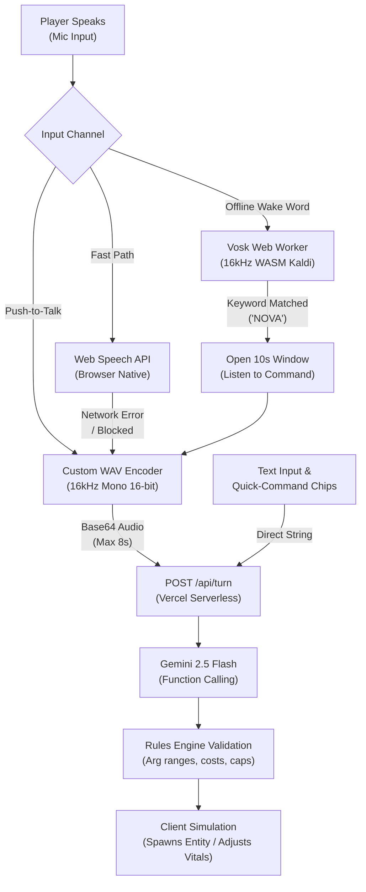
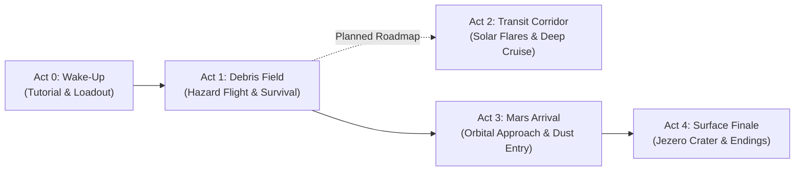
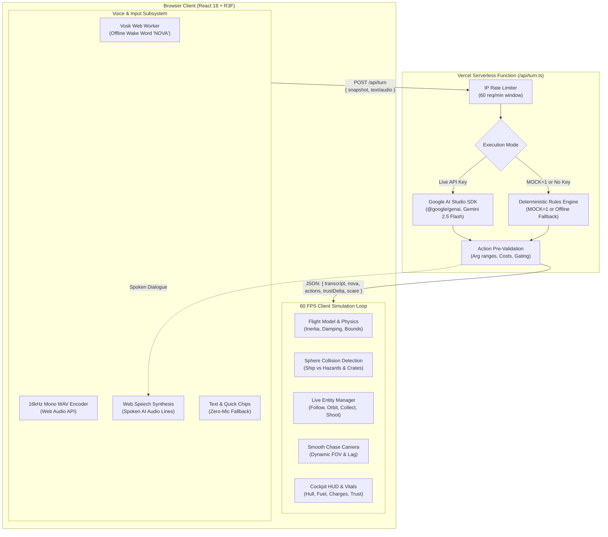

<div align="center">


<br /><br />


# DEAR NOVA

**NASA Space Apps Challenge 2026 — Space Mission Design Game**  
*A real-time 3D space mission flight game with an unpredictable voice AI co-pilot who can alter reality around you.*

[](./LICENSE)
[](https://react.dev/)
[](https://threejs.org/)
[](https://vercel.com/)
[](https://ai.google.dev/)
[](https://alphacephei.com/vosk/)
[](./tests/)

<!-- TODO: Insert Live Demo Badge & Link once deployed: [](https://your-deployment-url.vercel.app) -->
<!-- TODO: Insert Project Video Demo Link: [](https://youtube.com/...) -->

</div>

---

## 📑 Table of Contents
- [Project Overview](#-project-overview)
- [Story & Premise](#-story--premise)
- [Flight Controls](#-flight-controls)
- [Voice & Summoning System](#-voice--summoning-system)
- [NOVA Persona & Response Types](#-nova-persona--response-types)
- [Mission Acts & Endings](#-mission-acts--endings)
- [System Architecture](#-system-architecture)
- [Tech Stack](#-tech-stack)
- [Project Structure](#-project-structure)
- [Getting Started](#-getting-started)
- [Environment Variables](#-environment-variables)
- [Vercel Deployment Guide](#-vercel-deployment-guide)
- [NASA Science Notes](#-nasa-science-notes)
- [Roadmap](#-roadmap)
- [Team](#-team)
- [Credits & License](#-credits--license)

---

## 🚀 Project Overview

**Dear NOVA** reimagines space mission design as a **real-time 3D flight game with an active voice AI co-pilot**. 

Instead of typing into a static turn-based chat box, you pilot the spacecraft ***Odyssey-1*** in 60 FPS flight while talking aloud to **NOVA**—the ship's autonomous AI. NOVA doesn't just answer questions; she has physical dominion over the local fabric of space. You can command her to summon repair drones, materialize fuel crates, deploy orbital escort fighters, reveal navigational course rings, or open spatial shortcuts.

### ⏱️ 30-Second Summary for Judges
- **The Challenge:** NASA Space Apps "Space Mission Design Game"—teach orbital mechanics, budget trade-offs, and mission risks in an engaging game.
- **The Innovation:** Dual-loop architecture separating a **60 FPS local arcade flight loop** (physics, inertia, collisions, entity behaviors) from an **asynchronous AI voice loop** (Vosk local wake word, browser WAV capture, and Google AI Studio Gemini function-calling on serverless endpoints).
- **Core Mechanic:** The **Summoning Matrix** ($\text{Entity} = \text{Skin} \times \text{Behavior} \times \text{Label} \times \text{Effect}$). Any spoken request is safely mapped to bounded in-game entities with strict charge costs.
- **Resilience:** Dual-path voice capture (local Vosk wake-word + Web Speech API + 16 kHz mono WAV fallback) with 100% playable keyboard and quick-command chips. Zero crashes on network drops.

<!-- TODO: Add Gameplay GIF here once recorded -->
<!-- <div align="center"></div> -->

---

## 🌌 Story & Premise

Humanity's first crewed mission to Mars is underway aboard the deep-space transport ***Odyssey-1***. The crew rests in cryosleep. You are the Commander, awake to guide the ship through critical maneuvers.

Your sole companion is **NOVA** (*Neural Orbital Vector Assistant*), an experimental learning AI trained on simulation records of every commander before you. NOVA is helpful, sarcastic, and mischievous. Her quirks, monkey's-paw twists, and unexpected scares are not bugs—they are psychological stress tests to determine if you can keep your composure when things go sideways in deep space, and whether she can trust you with humanity's most expensive mission.

---

## 🕹️ Flight Controls

The client flight loop runs locally at 60 FPS with responsive arcade inertia, velocity damping, speed caps, and a smooth third-person chase camera.

| Platform | Thrust / Strafe | Pitch / Yaw (Steer) | Boost (Thrusters) | Comms / Voice | Secondary |
|---|---|---|---|---|---|
| **Desktop** | **W / S** (Forward / Retro)<br>**A / D** (Strafe Left / Right)<br>**Q / E** (Up / Down) | **Mouse** (Smooth look) or **Arrow Keys** | **Left Shift** *(consumes fuel)* | Hold **V** or **Space** *(Push-to-Talk)*<br>or hands-free *"NOVA"* wake word | **Tab** (Mission Loadout)<br>**` (Tilde)** (Physics Debug GUI) |
| **Mobile** | **Left Virtual Joystick** | **Drag Right Screen** | On-screen **Boost** button | Tap on-screen **Mic** button | Top HUD drawer for loadout & settings |

---

## 🎙️ Voice & Summoning System

### 1. The Summoning Matrix
Players can ask NOVA for assistance at any time. NOVA maps player intent to a safe archetype:
$$\text{Entity} = \text{Skin} \times \text{Behavior} \times \text{Label} \times \text{Effect}$$

- **Skins:** `orb | crate | rock | ship | creature | station`
- **Behaviors:** `follow | orbit | collect | hazard | decor | shoot`
- **Effects:** `heal | fuel | shield | reveal_path | none`

### 2. Built-in Summon Presets
| Preset | Skin | Behavior | Effect | Charge Cost | Gameplay Purpose |
|---|---|---|---|:---:|---|
| `supply_crate` | `crate` | `collect` | `+fuel` (+30%) | **1** | Materializes ahead; fly through to replenish thruster propellant. |
| `repair_drone` | `orb` | `follow` (30s) | `heal` (+20%) | **2** | Tethers to ship starboard; steadily repairs damaged hull plating. |
| `escort_fighter` | `ship` | `follow + shoot` | `shield` | **2** | Intercepts, tracks, and destroys nearby asteroids and debris. |
| `beacon_satellite` | `station` | `orbit` | `reveal_path` | **1** | Projects glowing waypoint rings highlighting the optimal flight vector. |
| `wormhole_shortcut` | `orb` | `collect gate` | `warp` | **4** | Spatial aperture that warps the vessel ahead along the mission path. |
| `derelict_ship` | `ship` | `decor + pickup` | `lore + reward` | **2** | Salvage wreck with audio log recovery and small fuel cache. |
| `asteroids` | `rock` | `hazard` | `damage` | **0** | Cosmic hazards spawned by NOVA on twists or low-trust pranks. |
| `ghost_ship` | `ship` | `decor scare` | `scare` | **0** | Spectral sighting spawned during Act 1/2 scares (scareLevel = 2). |

### 3. Anti-Exploit Guardrails
- **Summon Capacitors:** 5 charges maximum. Charges regenerate at 1 per 20 seconds (faster with high trust).
- **Entity Ceiling:** Maximum 12 active entities in the scene simultaneously; max 5 spawned per turn.
- **Safe Spawn Radius:** Objects materialize at a safe distance ahead or around the ship—never intersecting the ship mesh.
- **Creative Fallback:** Unrecognized requests (e.g. *"NOVA, summon a space whale"*) are playfully acknowledged and mapped to bounded archetypes (`skin: 'creature'`, `behavior: 'orbit'`).

### 4. Tri-Tier Voice Architecture


1. **Local Wake-Word Engine:** Uses `vosk-browser` (WebAssembly Kaldi acoustic model `vosk-model-small-en-us-0.15`) in a Web Worker + fuzzy phonetic Levenshtein matcher (`"NOVA"`, `"Noah"`, `"Nover"`). Zero audio data leaves the device while in idle state.
2. **Browser Web Speech API:** Used as low-latency transcription fast-path when supported.
3. **Primary Audio Fallback:** Automatically encodes 16 kHz 16-bit mono WAV clips (capped at 8 seconds, ~256 KB base64) via Web Audio API `AudioContext` and submits them to `/api/turn` for multimodal server-side transcription and action execution.
4. **Zero-Mic Fallback:** Text bar and quick-command chips (`"NOVA, summon a supply crate"`, `"NOVA, repair ship hull"`, `"NOVA, status report"`) ensure 100% full gameplay without microphone access.

---

## 🤖 NOVA Persona & Response Types

NOVA's behavior is driven by her **Trust Meter** (0–100, begins at 60). Every interaction selects exactly one response type:

| Response Type | Description | Trigger Conditions |
|---|---|---|
| `grant` | Executes the request smoothly with encouraging dialogue. | High trust ($\ge 70$), standard polite commands. |
| `grant_with_cost` | Fulfills the request with a visible trade-off (fuel burn, power drain, or charge cost). | Normal trust (40–69), heavy resource requisitions. |
| `twist` | Monkey's-paw interpretation (e.g. asked for light, got cabin lights out and thruster glow). | Annoyed trust (15–39), ambiguous commands. |
| `refuse` | Tactfully or sarcastically declines with an in-character physics explanation. | Insufficient charges, out-of-bounds requests, spam. |
| `prank` | Audiovisual glitch (flicker, alarm, or blackout) followed by a witty quip. | Harmless surprise; respects `scareLevel` setting. |

- **Trust Impact:** Courteous language and good piloting raise trust (+3 to +5); spamming, abusive language, or trying to jailbreak the AI drops trust (-5 to -12).
- **Scare Setting (`scareLevel`):** `0: Off` (no jumpscares or light flickers), `1: Mild` (audio chimes, UI flickers), `2: Full` (cabin blackout, viewport silhouette).

---

## 🗺️ Mission Acts & Endings

### Mission Acts


- **Act 0: Wake-Up (Tutorial & Mission Design):** Low Earth Orbit reboot. Guided 5-step interactive sequence (Thrust -> Boost -> Voice Summon -> Hull Repair -> Creative Summon). Includes a **Skip Tutorial** button and loadout allocation screen (splitting points between Fuel Tank, Hull Armor, Science Payload, and Summon Capacitors).
- **Act 1: Debris Field:** High-speed evasion through dense asteroid clusters and space junk. Players must summon repair drones, shields, or escort fighters to survive.
- **Act 2: Transit Corridor:** *(Marked as Roadmap)* Interplanetary transfer cruise with solar flare evasion and time-skips.
- **Act 3: Mars Arrival:** High-orbit insertion and descent gates through Martian atmospheric dust storms.
- **Act 4: Surface Finale & Touchdown:** Final descent onto Jezero Crater, rover deployment, surface science reading, and telemetry transmission back to Earth.

### The 4 Endings
1. 🌟 **Co-Pilot Ending (Trust $\ge 70$, Landed):** NOVA reveals her pranks were psychological readiness tests, commends you as an equal partner, and assists in a flawless synchronized landing.
2. 🎖️ **Professional Ending (Trust $40-69$, Landed):** Clean mission success. Ground control receives science data and NOVA logs a formal mission commendation.
3. ⚠️ **Lockout Ending (Trust $< 40$, Landed):** NOVA disengages automated flight assistance due to low trust. The commander must land manually with high difficulty.
4. 🌑 **Lost in the Dark Ending (Hull or Fuel reaches 0):** Vessel disabled in deep space. NOVA transmits a quiet, reflective sign-off and provides a checkpoint restart option.

---

## 🏗️ System Architecture



---

## 🛠️ Tech Stack

| Technology / Tool | Version | Where Used | Why We Chose It |
|---|---|---|---|
| **React** | `^18.3.1` | Frontend Core | Declarative UI component tree, state synchronization, and R3F integration. |
| **Three.js** | `^0.170.0` | 3D Graphics Engine | Industry-standard WebGL rendering engine with lightweight mobile support. |
| **@react-three/fiber** | `^8.17.10` | 3D React Bridge | Allows declarative composition of 3D scene graphs inside React's render lifecycle. |
| **@react-three/drei** | `^9.120.4` | 3D Scene Helpers | Provides optimized starfields, cameras, loaders, and procedural geometries. |
| **Zustand** | `^5.0.1` | Client State Store | Zero-boilerplate, high-performance state store powering the 60 FPS flight loop. |
| **vosk-browser** | `^0.0.8` | Local Voice Wake Word | Runs an offline 16 kHz Kaldi acoustic model in a Web Worker; zero audio leaves the device. |
| **@google/genai** | `^3.3.0` | Serverless AI Backend | Official Google Gen AI SDK for Gemini function calling on `/api/turn`. |
| **Vercel Serverless** | Node.js 20+ | Backend Runtime | Zero-configuration serverless hosting with native TypeScript support and 30s `maxDuration`. |
| **Lucide React** | `^0.460.0` | Cockpit UI Icons | Clean, lightweight SVG iconography for flight telemetry and gauges. |
| **Canvas Confetti** | `^1.9.4` | Victory Screen | Instant celebratory particle burst on mission completion with zero DOM overhead. |
| **Tailwind CSS** | `^3.4.15` | Cockpit UI Styling | Fast, utility-first CSS styling for sci-fi holographic interfaces. |
| **Vite** | `^5.4.11` | Build & Dev Tool | Fast HMR dev server with custom `/api/turn` mock middleware and optimized Rollup bundling. |
| **TypeScript** | `^5.6.3` | Full Stack | Enforces shared contract interfaces across client simulation and serverless endpoints. |
| **Node.js Test Runner** | `node --test` | Automated Testing | Built-in zero-dependency test runner executing 45 unit and integration tests. |

---

## 📁 Project Structure

```text
dear-nova/
├── .env.example                  # Environment variable template (keys omitted)
├── .gitignore                    # Excludes node_modules, dist, .env, .vercel, .vite
├── LICENSE                       # MIT License
├── CREDITS.md                    # Third-party software, models, and audio attributions
├── vercel.json                   # Vercel deployment config (Vite preset, maxDuration: 30s)
├── package.json                  # Dependencies & scripts
├── vite.config.ts                # Vite dev server with /api/turn mock middleware
├── assets/
│   ├── banner.svg                # Vector repository banner
│   └── logo.svg                  # Vector NOVA core logo
├── public/
│   └── models/                   # Low-poly 3D models & speech assets
│       ├── CREDITS.md            # 3D polygon budgets & NASA reference citations
│       ├── ship.glb              # Player vessel (NOVA-1)
│       ├── earth.glb             # Earth model (Visible Earth contours)
│       ├── mars.glb              # Mars model (MOLA altimetry dataset)
│       ├── moon.glb & rover.glb  # Moon & ARES-V surface science rover
│       ├── skin_*.glb            # 6 Entity summon skins (orb, crate, rock, ship, etc.)
│       └── vosk-model-*.tar.gz   # Offline 16 kHz acoustic model (41.1 MB)
├── api/                          # Vercel Serverless Functions
│   ├── turn.ts                   # POST /api/turn entry point (CORS, rate limit, fallback)
│   └── _lib/
│       ├── engine.ts             # Deterministic rules engine & action validator
│       ├── gemini.ts             # Google AI Studio Gemini function-calling client
│       ├── mock.ts               # Offline scripted mock turn handler
│       ├── types.ts              # Contract types & entity interfaces
│       ├── data/                 # Preset costs and balance tables
│       └── prompts/              # NOVA persona system prompts
├── src/                          # Client Source Code (Vite + React)
│   ├── App.tsx                   # Top-level state coordinator
│   ├── main.tsx & index.css      # React DOM mount & Tailwind base styling
│   ├── components/               # Cockpit HUD, command bar, modals, tutorial overlay
│   ├── game/                     # State store, flight model, voice managers, audio haptics
│   └── scene/                    # 3D scene graphs, starfield, planets, chase camera, particles
└── tests/                        # 45 Automated Unit & Integration Tests
    ├── TEST_PLAN.md              # Master QA test plan & device verification matrix
    ├── BUGS.md                   # Bug tracking register
    ├── v2_engine.test.ts         # Rules engine & action validation tests
    ├── v2_qa_test_suite.ts       # Full end-to-end integration test suite
    ├── wakeWordMatcher.test.ts   # Phonetic fuzzy matcher test suite
    └── localVoiceManager.test.ts # State machine & 1.2s silence detector tests
```

---

## ⚡ Getting Started

### 1. Prerequisites
- **Node.js:** `v18.0.0` or higher (`v20+` recommended)
- **Package Manager:** `npm` (v9+) or `pnpm`

### 2. Clone & Install
```bash
git clone https://github.com/NASA-Space-Apps-Challenge-Pew-Pew/Dear-Nova.git
cd Dear-Nova
npm install
```

### 3. Run Automated Tests
```bash
npm test
```
*Executes all 45 unit and integration tests (engine validation, wake-word matching, WAV encoding, and controls).*

### 4. Run Development Server
```bash
npm run dev
```
Open **`http://localhost:5173`** in Chrome, Edge, or Safari. The local Vite server includes an integrated middleware mock for `/api/turn`—no external serverless daemon required.

### 5. Build for Production & Preview
```bash
npm run build
npm run preview
```
Serves the production build locally at `http://localhost:4173`.

---

## 🔐 Environment Variables

Create a `.env.local` file in the root directory for local testing with real Gemini models:

```bash
# Server-side only (never exposed to frontend bundles)
GEMINI_API_KEY=your_google_ai_studio_api_key_here
GEMINI_MODEL=gemini-3.5-flash-lite
ALLOWED_ORIGIN=*
MOCK=0
```

> **Note:** If `GEMINI_API_KEY` is omitted or `MOCK=1`, the game automatically executes using the built-in deterministic rules engine. You can play through all acts offline without an API key!

---

## 🚢 Vercel Deployment Guide

Deploying Dear NOVA to Vercel takes under 2 minutes:

1. **Push to GitHub:** Push your code to your GitHub repository.
2. **Import Project in Vercel:**
   - Navigate to [vercel.com/new](https://vercel.com/new).
   - Select the `Dear-Nova` repository.
3. **Verify Build Configuration:**
   - **Framework Preset:** `Vite`
   - **Build Command:** `npm run build`
   - **Output Directory:** `dist`
4. **Configure Environment Variables:**
   Under **Project Settings > Environment Variables**, add:
   - `GEMINI_API_KEY`: *(Your Google AI Studio Gemini API key)*
   - `GEMINI_MODEL`: `gemini-3.5-flash-lite`
   - `ALLOWED_ORIGIN`: `*` (or your production domain)
5. **Deploy:** Click **Deploy**. Vercel will build the frontend bundle and automatically provision `/api/turn.ts` as a serverless function with a 30-second execution allowance.

---

## 🔬 NASA Science Notes

All orbital calculations, celestial references, and mission constraints in Dear NOVA are modeled after published NASA mission design parameters:

1. **Earth-Mars Launch Windows (~26 Months):**
   - Earth and Mars orbital alignments suitable for minimum-energy Hohmann transfer orbits occur once every **~780 days (approximately 25.6 months)** due to the synodic period between the two planets.
   - *Source:* [NASA JPL Basics of Space Flight — Chapter 4: Interplanetary Trajectories](https://www.jpl.nasa.gov/edu/teach/activity/lets-go-to-mars-calculating-launch-windows/)
2. **Interplanetary Cruise Duration (~210 Days):**
   - A standard Hohmann transfer orbit between Earth and Mars requires approximately **6 to 9 months (~180 to 270 days)** of transit time depending on planetary eccentricity and injection delta-v.
   - *Source:* [NASA Moon to Mars Architecture Definition Document (ADD)](https://www.nasa.gov/humans-in-space/moon-to-mars-architecture/)
3. **Surface Landing Site (Jezero Crater):**
   - The mission touchdown target is Jezero Crater ($18.38^\circ\text{N}, 77.58^\circ\text{E}$), the ancient paleolake basin explored by NASA's Mars 2020 *Perseverance* rover.
   - *Source:* [NASA Mars 2020 Perseverance Rover Science](https://science.nasa.gov/mission/mars-2020-perseverance/)
4. **Spacecraft Architecture Reference:**
   - The player vessel *Odyssey-1* references NASA's Deep Space Transport (DST) concept, utilizing modular habitat living quarters, deployable photovoltaic solar wings, and high-efficiency ion propulsion.

---

## 🗺️ Roadmap

- [x] **V2 Flight Physics & Controls:** 60 FPS real-time arcade momentum, WASD/mouse look, and mobile virtual joystick.
- [x] **Summoning Matrix:** 8 presets (`supply_crate`, `repair_drone`, `escort_fighter`, `beacon_satellite`, `wormhole_shortcut`, `derelict_ship`, `asteroids`, `ghost_ship`) + custom bounded archetype generator.
- [x] **Tri-Tier Voice Engine:** Vosk offline WebAssembly wake word, Web Speech API fast-path, and 16 kHz mono WAV audio fallback.
- [x] **Act 0 (Wake-Up):** 5-step interactive tutorial with skip option and mission loadout configuration screen.
- [x] **Act 1 (Debris Field):** High-speed debris evasion, asteroid collisions, and emergency summoning under pressure.
- [x] **Act 3 (Mars Arrival):** High-orbit approach and atmospheric entry descent gates.
- [x] **Act 4 (Surface Finale):** Jezero Crater landing, rover deployment, science telemetry transmission, and 4 endings.
- [ ] **Act 2 (Transit Corridor):** Deep-space interplanetary cruise corridor with solar flare shielding and time-skip gates. *(Roadmap)*
- [ ] **Audio Sound Effects:** Procedural Web Audio thruster hums, alarm sirens, and impact hit-markers. *(Roadmap)*
- [ ] **WebXR / Cockpit VR Mode:** Direct VR headset cockpit immersion. *(Roadmap)*

---

## 👥 Team

Built with ❤️ for the **NASA Space Apps Challenge 2026** by **Team Pew Pew**:

- **Justine Roy P. Salvador** — Project Lead & Software Architecture
<!-- TODO: Add other team members here -->
<!-- - **[Team Member Name]** — [Role / Contribution] -->
<!-- - **[Team Member Name]** — [Role / Contribution] -->
<!-- - **[Team Member Name]** — [Role / Contribution] -->

---

## 📄 Credits & License

- **Source Code License:** Distributed under the **MIT License**. See [`LICENSE`](./LICENSE) for terms.
- **Third-Party Attributions:** Complete breakdown of open-source libraries, models, and acoustic datasets is available in [`CREDITS.md`](./CREDITS.md).
- **3D Asset Poly Budgets & NASA References:** Documented in [`/public/models/CREDITS.md`](./public/models/CREDITS.md).

<div align="center">
<sub>NASA Space Apps Challenge 2026 · Space Mission Design Game · Team Pew Pew</sub>
</div>
